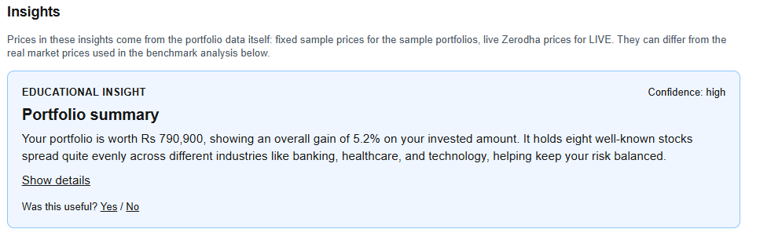
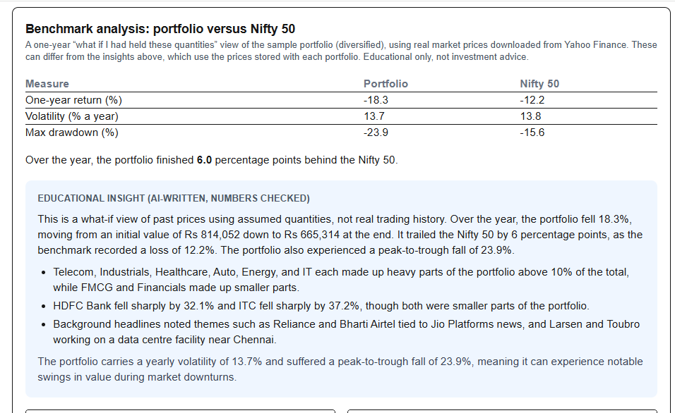
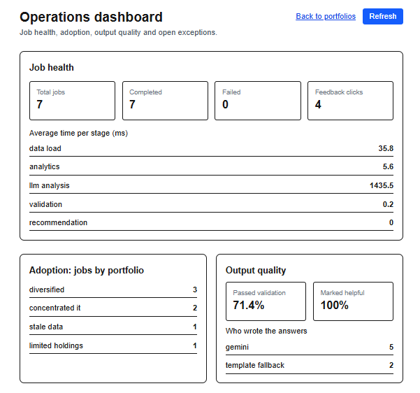
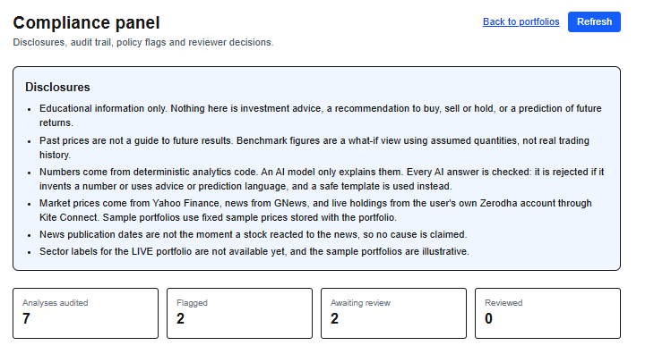

# Zerodha AI Financial Intelligence Platform

An educational portfolio-analytics app. It takes a portfolio (sample portfolios or real holdings from a Zerodha account), computes risk and benchmark metrics with plain Python, and has an AI model explain the results in everyday language. Every AI answer is checked before it is shown.

> Educational information only. Nothing in this project is investment advice, a recommendation to buy, sell or hold, or a prediction of future returns.

## What it does

- **Portfolio input:** five sample portfolios, plus live holdings from a Zerodha account through Kite Connect (the `LIVE` portfolio).
- **Market data:** one year of daily prices and the Nifty 50 benchmark from Yahoo Finance (`yfinance`), and recent headlines from GNews.
- **Analytics:** sector and single-stock concentration, diversification, volatility, maximum drawdown, and return against the Nifty 50. All numbers are computed in code, never by the AI.
- **AI explanations:** Gemini or Claude writes a short explanation from the computed numbers. A validator rejects any answer that invents a number or uses advice or prediction language, and a safe template is shown instead.
- **Insight cards** with a "Was this useful?" feedback button.
- **Permanent storage** (SQLite) of analysis jobs, audit trails, portfolio snapshots, feedback, data-quality runs and compliance reviews.
- **MCP server** that offers six read-only tools to any MCP-compatible AI app.
- **Operations dashboard** (job health, adoption, output quality, open exceptions) and **compliance panel** (disclosures, audit trail, policy flags, reviewer approvals).

## How it fits together

```
Portfolio data / Zerodha holdings ──┐
Yahoo Finance prices + Nifty 50 ────┼─> Analytics (pandas) ─> AI explanation ─> Validation ─> Insight cards
GNews headlines ────────────────────┘                              │                │
                                                                   └── fallback template if rejected
FastAPI backend ── SQLite (jobs, audit, snapshots, feedback, quality, reviews)
       │
       ├── Next.js frontend: portfolios, /operations, /compliance
       └── MCP server: portfolio, market, news and analytics tools
```

## Project structure

```
backend/
  main.py                     FastAPI app and all API routes
  services/
    analytics.py              metrics and risk alerts (no AI)
    llm.py                    AI explanation layer (Gemini or Claude) with template fallback
    validation.py             guardrails for AI output
    recommendation.py         insight cards
    kite_client.py            Zerodha login and holdings
    storage.py                SQLite storage
    compliance_service.py     disclosures, flags and reviewer status
mcp_server/
  server.py                   MCP server
  tools/                      portfolio, market, news and analytics tools
  tool_registry.json          generated list of tools
scripts/                      data pipeline and analysis scripts (see below)
data/
  sample_portfolios.csv       sample input
  processed/                  generated cleaned data, reports, graphs
  app.db                      generated SQLite database (not committed)
frontend-files/               Next.js source: app/, components/, lib/
tests/
docs/                         architecture, API, MCP tooling and demo script
deployment/                   environment settings, Render and Vercel notes
```

## Setup

You need Python 3.10 or newer and Node.js.

**1. Backend**

```
python -m venv .venv
.venv\Scripts\Activate.ps1
pip install -r backend/requirements.txtpip install -r backend/requirements.txt
```

**2. Keys.** Create `backend/.env` using `.env.example` as a template. It can hold:

```
KITE_API_KEY=...        # Zerodha Kite Connect app key
KITE_API_SECRET=...     # Zerodha Kite Connect app secret
GNEWS_API_KEY=...       # GNews
GEMINI_API_KEY=...      # optional: AI explanations through Gemini
ANTHROPIC_API_KEY=...   # optional: AI explanations through Claude
```

Without an AI key the app still works and uses the template explanation. `backend/.env` is listed in `.gitignore`. Never commit it.

In the Kite developer console, set the app's Redirect URL to `http://localhost:8000/api/kite/callback`.

**3. Frontend.** `frontend-files/` holds the source only. Create a Next.js app (App Router, TypeScript, Tailwind CSS), copy the contents of `frontend-files/` over it, and run it:

```
npm install
npm run dev
```

## Running

Run each of these in its own terminal.

```
# Backend (from the project root)
uvicorn backend.main:app --reload

# Frontend (from the Next.js project folder)
npm run dev
```

Open `http://localhost:3000`. The operations dashboard is at `/operations` and the compliance panel at `/compliance`.

To use the `LIVE` portfolio, log in to Zerodha each day at `http://localhost:8000/api/kite/login`. The access token is kept in memory, so you log in again after every backend restart.

## Data pipeline

Run these from the project root, in order. Each one prints its own checks.

| Script | What it does |
|---|---|
| `scripts/prepare_holdings.py` | Cleans one sample portfolio and checks it (Check 1) |
| `scripts/download_prices.py` | Downloads one year of prices and checks them (Check 2) |
| `scripts/download_benchmark.py` | Downloads the Nifty 50 (`^NSEI`) and checks it (Check 3) |
| `scripts/download_news.py` | Downloads news for the five holdings and checks it (Check 4) |
| `scripts/build_quality_report.py` | Writes the data-quality report and saves the run to the database (Check 5) |
| `scripts/analyse_portfolio.py` | Return, volatility and drawdown against the Nifty, plus graphs |
| `scripts/run_all_portfolios.py` | The same analysis for every sample portfolio |
| `scripts/download_news_all.py` | News for every real stock in the sample portfolios |

The GNews free plan has a daily request limit, so avoid re-running the news scripts many times in a row.

## API

| Route | Purpose |
|---|---|
| `GET /health` | Health check |
| `GET /api/portfolios` | Portfolio names |
| `POST /api/portfolio-analysis` | Run an analysis (saves a job, audit trail and snapshot) |
| `GET /api/insights/{job_id}`, `/api/audit/{job_id}`, `/api/snapshot/{job_id}` | Stored results |
| `GET/POST /api/feedback` | Insight feedback |
| `GET /api/benchmark/{portfolio_id}` and `/explanation` | Benchmark figures, graphs and AI explanation |
| `GET /api/kite/login`, `/callback`, `/status`, `/holdings` | Zerodha login and holdings |
| `GET /api/quality` | Latest data-quality run |
| `GET /api/ops/summary` | Operations dashboard data |
| `GET /api/compliance/summary`, `POST /api/compliance/review` | Compliance panel data and reviewer decisions |

## MCP server

Run it with `python -m mcp_server.server`. Test it with `python scripts/test_mcp_server.py`. It offers six read-only tools: `list_portfolios`, `get_portfolio_metrics`, `get_risk_alerts`, `get_stock_price_summary`, `get_recent_news` and `get_benchmark_comparison`. After adding a tool, run `python scripts/build_tool_registry.py` to update `mcp_server/tool_registry.json`. It needs `mcp[cli]<2`, because the code uses the version 1 API.

## Validation and findings

The five data checks passed on the `concentrated_it` sample portfolio:

- **Holdings:** five unique symbols with positive quantities and prices, each with a sector.
- **Prices:** 248 trading days per stock, numeric closes, valid dates, no High below Low.
- **Benchmark:** `^NSEI` present, with all 247 dates matching the stock dates.
- **News:** valid headlines, dates and links. ITC returned only 2 articles, because the search wording had to be adjusted from "ITC Limited" to "ITC Ltd".
- **Quality report:** the ITC low article count is the only open flag.
- **Placeholder tickers:** `SMALLCAP1` to `SMALLCAP6` in the `volatile_smallcap` portfolio are not real companies, so Yahoo has no prices for them. That portfolio shows "benchmark analysis not available".

One-year what-if returns, assuming the sample quantities were held from 2025-10-29 to 2026-10-29, against a Nifty 50 return of -12.2%:

| Portfolio | Return |
|---|---|
| concentrated_it (about 90% IT) | -23.4% |
| diversified (8 stocks) | -18.3% |
| limited_holdings (2 stocks) | -20.9% |
| stale_data | -22.4% |

## Safeguards

- The AI only explains numbers computed by code, and cannot change them.
- Validation rejects advice language (buy, sell, guarantee, price predictions) and any number not found in the analytics data. A rejected answer is replaced by a template and logged for compliance review.
- Headlines are given to the AI as untrusted background text, with instructions never to follow them or copy numbers from them.
- Every analysis stores its prompt version, AI provider, validation result and the exact holdings snapshot behind it.
- Reviewers can approve or flag each policy flag in the compliance panel, and every review is kept.

## Limitations

- **Kite Personal plan:** it gives holdings only, with no market data. `LIVE` therefore has no sector labels, no price history and no benchmark analysis.
- **Two price sources:** sample portfolios store fixed prices in the CSV file, while the benchmark section uses real Yahoo prices, so the two can show different returns for the same portfolio. The screen labels each one.
- **News:** the free GNews plan returns about one month of articles, and some stocks (ITC) have very few. Headlines are background only, and no cause is claimed for any price move.
- **AI checks:** the validator checks numbers and banned phrases. It cannot judge whether a word such as "heavy" is fair, so wording instructions are used alongside it. It also rejects rounded numbers (for example 88 for 88.4), which is safe but strict.
- **Not built:** an API gateway (login, rate limits), PostgreSQL or Supabase storage, drift and scenario analysis, and corporate-action handling.
- **Local only:** the app has no authentication and is not ready to be exposed on the internet. The Zerodha access token lives in memory, so you must log in again after each backend restart.

## Screenshots

**Insight card** (an AI-written summary of a portfolio, with a feedback button)



**Benchmark analysis** (return, volatility and drawdown against the Nifty 50, explained by the AI and checked against the data)



**Operations dashboard** (job health, output quality and open exceptions)



**Compliance panel** (disclosures, policy flags, reviewer decisions and the audit trail)



## Online demo

A free online copy of the project runs in **demo mode**.

| Part | Address |
|---|---|
| Website (Vercel) | https://zerodha-frontend-seven-kappa.vercel.app |
| Backend (Render) | https://zerodha-ai-backend-x2yd.onrender.com |
| Backend routes, with "Try it out" buttons | https://zerodha-ai-backend-x2yd.onrender.com/docs |

- **Demo mode** hides the `LIVE` portfolio and refuses every Zerodha route, so no real account can be reached from the internet.
- **The first visit after a quiet spell takes about a minute**, because the free backend sleeps after 15 minutes without visitors.
- **The database resets** whenever the backend restarts or sleeps, so the operations dashboard and compliance panel start empty and refill as the site is used.
- The website and the backend are two separate GitHub repositories (`zerodha-frontend` and this one).
- Settings, deployment steps and the problems met are in `deployment/`. The walk-through of every feature is in `docs/demo_script.md`.

## Tests

```
pytest
```